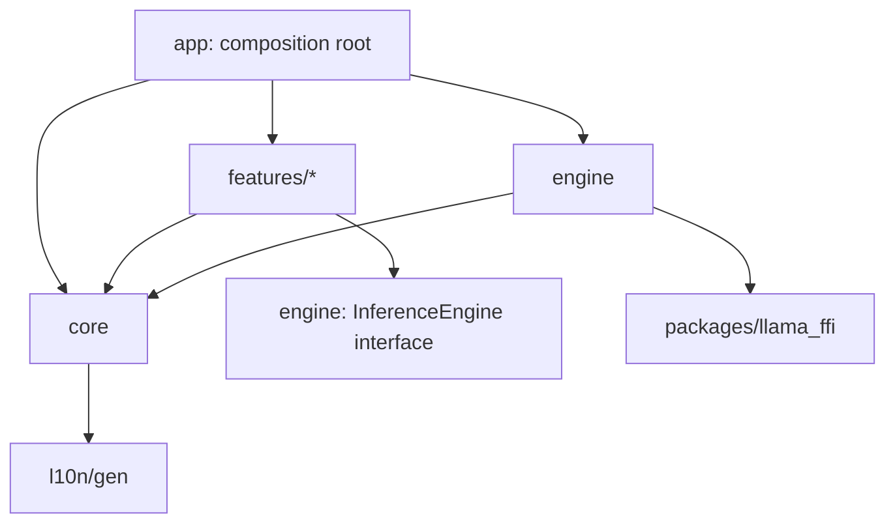
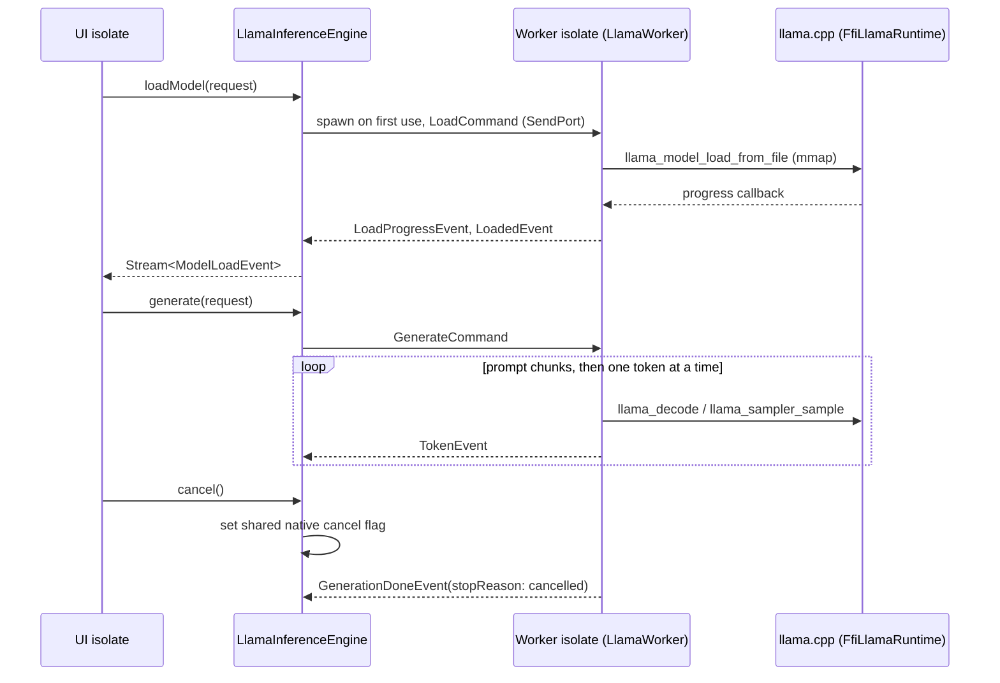
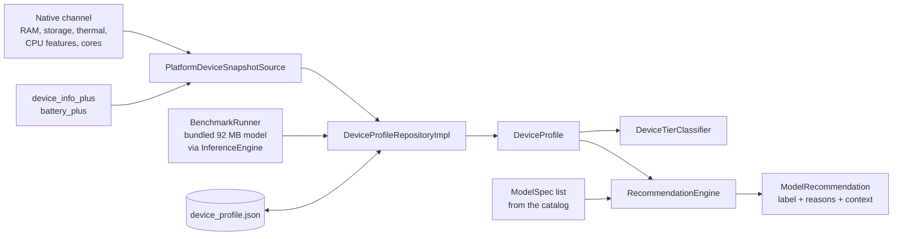
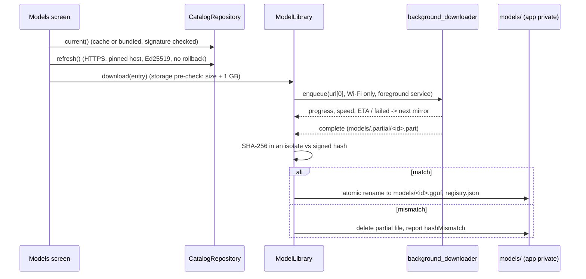
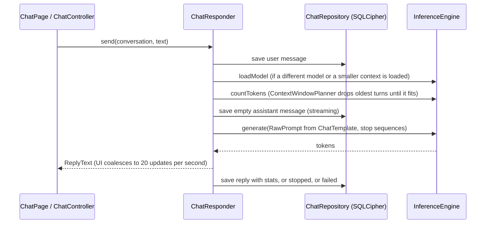
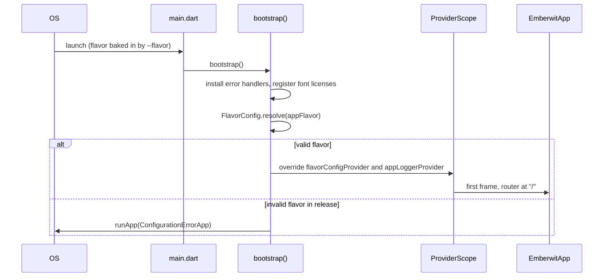

# Architecture

Emberwit is a Flutter app that runs large language models entirely on the
phone. This document describes how the code is organised and which parts may
depend on which. It grows with each delivery phase.

## Principles

1. **Offline first.** Only two things use the network: fetching the model
   catalog and downloading models. Everything else works in airplane mode.
2. **Nothing leaves the device.** There are no accounts, no telemetry and no
   analytics. Logs never contain user content.
3. **Feature first, layered inside.** Each feature has `presentation`,
   `domain` and `data` layers. Features never import each other.
4. **Errors are values.** Domain and data layers return `Result<T>` with a
   sealed `AppFailure`. Exceptions never cross a layer boundary.
5. **Dependency injection through Riverpod only.** Concrete implementations
   are chosen in providers. Tests swap them with overrides.
6. **The UI thread never blocks.** Inference runs in a long lived background
   isolate.

## Folder layout

```
lib/
  main.dart            Entry point for every flavor. Calls bootstrap().
  app/                 Composition root: app widget, bootstrap, router, theme.
    bootstrap.dart     Error handlers, flavor resolution, ProviderScope.
    app.dart           EmberwitApp (MaterialApp.router), locale resolution.
    router/            AppRoutes (paths) and the GoRouter provider.
    theme/             Material 3 light and dark themes, brand colors.
    shell/             App level screens: welcome, not found, flavor banner.
  core/                Shared by everything. Depends on nothing else in lib/.
    config/            AppFlavor and FlavorConfig (catalog URL, app name).
    constants/         Product constants (app name).
    errors/            Sealed AppFailure hierarchy.
    l10n/              context.l10n extension.
    logging/           AppLogger (debug logger, silent in release).
    preferences/       Theme and language preferences.
    providers/         Core providers: flavor config, logger, clock.
    result/            Result<T> = Ok | Err.
    utils/             Clock and other small utilities.
  core/device/         DeviceProfile, DeviceTier, tier classifier, repository contract.
  core/recommendation/ Pure Dart model recommendation engine.
  core/catalog/        Catalog types and the CatalogRepository contract.
  core/models/         InstalledModel, download state and the ModelLibrary contract.
  core/network/        HTTPS only Dio client, retries, SPKI certificate pinning.
  engine/              InferenceEngine interface and adapters.
    inference_engine.dart  The interface features use.
    engine_models.dart     Requests, events, stats (plain, isolate sendable).
    engine_providers.dart  inferenceEngineProvider: the one engine instance.
    llama/                 llama.cpp adapter: isolate protocol, worker, engine.
    text/                  Streaming UTF-8 decoding and stop sequences.
  features/            One folder per feature:
    device_profiler/   Platform snapshot, benchmark, profile cache, device check screen.
    model_catalog/     Signed catalog: Ed25519 verification, cache, bundled fallback.
    model_manager/     Downloads, SHA-256 verification, import, delete, models screen.
    chat/              Encrypted conversations, prompt templates, context window, chat UI.
    <feature>/
      domain/          Entities, repository interfaces, use cases. Pure Dart.
      data/            Repository implementations, data sources, DTOs.
      presentation/    Screens, widgets, Riverpod controllers.
  l10n/
    arb/               app_en.arb (template) and app_bn.arb.
    gen/               Generated AppLocalizations (not committed).
packages/
  llama_ffi/           llama.cpp FFI plugin as its own package (see its README).
    third_party/llama.cpp  Pinned git submodule (tag b11155).
```

Planned features: `onboarding`, `device_profiler`, `model_catalog`,
`model_manager`, `chat`, `settings`.

## Dependency rules



| From | May import |
|---|---|
| `core` | `core`, generated `l10n` |
| `engine` | `engine`, `core`, `packages/*` |
| `features/x` | `features/x`, `core`, the `engine` interface |
| `app` | anything |

`features/x` never imports `features/y`. When two features need to share a
contract (for example the chat feature needs "the installed models"), the
contract goes into `core` as an interface. The providing feature implements
it, and `app` wires the two together with a provider override.

`test/architecture/import_boundaries_test.dart` enforces these rules on every
CI run.

Inside a feature, `domain` imports neither `data` nor `presentation`, and has no
Flutter imports except `foundation` annotations.

## Inference engine

Features depend only on `InferenceEngine` (`lib/engine/inference_engine.dart`).
The llama.cpp adapter splits the work across two isolates:



- **Typed messages.** `llama_protocol.dart` defines sealed `WorkerCommand` and
  `WorkerEvent` classes. Each command carries an id that its events repeat.
- **Cancellation.** The worker is inside blocking native calls most of the
  time, so a cancel message would wait in its queue. Instead, the UI isolate
  sets an `Int32` flag in native memory. The worker checks it between prompt
  chunks, between tokens, and in the load progress callback, which aborts the
  load.
- **Text.** Tokens are byte sequences. `Utf8StreamDecoder` holds back
  incomplete UTF-8 sequences, which matters for Bengali: every character is 3
  bytes and often split across tokens. `StopSequenceMatcher` holds back text
  that could start a stop sequence.
- **Failures.** The worker converts `LlamaException`s into `AppFailure`s
  (`ModelLoadFailure` with a reason, `ContextOverflowFailure`, and so on).
  `describeFailure` in `core/l10n` turns them into localized messages with a
  suggestion. Nothing throws across the interface.
- **Worker crash.** If the worker isolate exits, pending requests fail with
  `UnexpectedFailure`, the state goes back to idle, and the next request
  starts a new worker.
- **Defaults.** The worker memory maps model files. CPU threads are
  `min(cores, 4)`. GPU layers are all layers on Apple Metal and none on
  Android. The device profiler (Phase 2) refines these defaults.

## Device profiler and recommendations



- **Contract in core, implementation in the feature.** `DeviceProfileRepository`
  and its provider live in `core/device`. The device_profiler feature
  implements it, and `lib/app/providers/feature_bindings.dart` connects the
  two. The catalog, onboarding and settings features will read the profile
  without importing device_profiler.
- **Native channel** `app.emberwit/device_profiler`
  (`DeviceProfilerChannel.kt`, `DeviceProfilerChannel.swift`):
  - `getSnapshot` returns live values. Android uses
    `ActivityManager.MemoryInfo`, `PowerManager` thermal status and battery
    saver, `StatFs`, `/proc/cpuinfo` flags, per-core maximum frequencies to
    count performance cores, and the Vulkan 1.1 feature. iOS uses
    `ProcessInfo.physicalMemory`, `os_proc_available_memory`, `thermalState`,
    `isLowPowerModeEnabled`, sysctl `hw.optional.arm.FEAT_*` and
    `hw.perflevel0`, and Metal.
  - `prepareAsset` makes the bundled benchmark model available as a file. On
    Android it is streamed out of the APK once. On iOS it is already a file in
    the app bundle.
- **Tiers.** `DeviceTierClassifier` sorts by reported RAM (low < 4.5 GiB,
  mid < 6.5 GiB, high < 10.5 GiB, flagship above). It then drops one tier for
  each missed benchmark bandwidth threshold. Default context by tier: 1024,
  2048, 4096 and 8192 tokens.
- **Benchmark.** It loads the bundled SmolLM2-135M Q4_0 model with a 512
  token context and generates greedily from a fixed prompt. It stops at 128
  tokens or 10 seconds (model load included), then unloads the model. The
  result (tok/s, time to first token, load time) is cached with the profile.
- **Recommendation rules** (`RecommendationEngine`, pure Dart, configurable):
  1. Memory: weights + KV cache for the context + 64 MB overhead must fit in
     45% of RAM on Android and 50% on iOS. The iOS figure relies on the
     increased memory limit entitlement in `ios/Runner/Runner.entitlements`.
     If a model does not fit, the context is halved down to 1024 tokens
     before the model is rejected.
  2. Storage: free space must exceed the file size plus 1 GB, unless the
     model is already installed.
  3. Speed: generation is memory bandwidth bound. Estimated tok/s = 0.85 ×
     (benchmark tok/s × benchmark model size) ÷ model size. Without a
     benchmark, an assumed bandwidth per tier is used. At or above 8 tok/s
     the model is Recommended, at 2 tok/s or more it Runs slowly, below that
     it is Not supported.
- **Reasons.** Each reason is a typed value. Presentation turns it into a
  localized sentence with `describeRecommendationReason` (English and
  Bengali, locale-aware numbers).

## Catalog and model manager



- **Trust chain.** The catalog is signed with Ed25519, and the app ships the
  public keys. Every model file must match the SHA-256 in the signed catalog
  before it leaves `.partial`. So a model can only be loaded if the catalog
  key holder vouched for its exact bytes. Imports are the one exception, and
  are labelled "Unverified import".
- **Offline first.** The catalog in use is the newest valid one among the
  on-device cache and the copy bundled with the app, so the list works with
  no network at all.
- **Downloads survive restarts.** `pending.json` records what is downloading
  and which mirror is in use. On start the library restores running transfers,
  verifies transfers that finished while the app was closed, and reports
  transfers that were lost. On Android, transfers run as a foreground service
  with a notification, so long downloads are not killed.
- **Storage.** Model files and records live in `<app support>/models`. That
  location is private to the app, excluded from Android backups (backup
  rules), and excluded from iCloud backup on iOS.

## Chat



- **Storage.** Drift on SQLCipher (AES-256). The 256-bit key comes from
  `Random.secure()` on first launch and lives only in flutter_secure_storage
  (Android Keystore; iOS Keychain, this device only). The database file is
  in `<app support>/chat`, excluded from backups. If the key is lost, the
  unreadable file is moved aside, never deleted. Android and iOS bundle the
  prebuilt SQLCipher. Linux (host tests, future desktop) uses the system
  `libsqlcipher` (`tool/build_host_sqlcipher.sh` on older distributions).
- **Templates.** `ChatTemplate` formats ChatML (Qwen3, with thinking switched
  off), Gemma, Llama 3 and Phi 4 exactly as the models were trained. Imported
  models get a template detected from their embedded Jinja template. User
  and model text is sanitised so a message can never open a new role or end
  the prompt (prompt structure injection).
- **Context window.** The system prompt and newest message always stay.
  Older turns are dropped oldest first until prompt + reply budget (at most
  half the context) fits, counted with the model's own tokenizer. The reply
  records how many messages were left out and the UI says so.
- **Reply language.** `ReplyLanguage.detect` reads the newest user message
  (Bengali script, romanized Bengali such as "kemon acho", or English) and
  the responder adds "Reply in English only" or "Reply in Bengali only, in
  Bengali script" to the system prompt for that reply. Messages without
  words (numbers, emoji) keep the language of the last one that had words.
  The app's display language plays no part.
- **Voice typing.** The mic in the message field uses the phone's own
  speech recognizer through `VoiceInputChannel.kt`, on-device only
  (`createOnDeviceSpeechRecognizer`, no network fallback; Android 8 to 11
  ask for offline with `EXTRA_PREFER_OFFLINE`). On Android 13+ the channel
  checks that the language pack is installed and can ask the system to
  download it. Heard text is placed in the field, after anything typed, and
  is sent only when the user sends it. English or Bengali, switched while
  listening (or by holding the mic) and remembered; a language the phone
  cannot listen in (unsupported or pack missing) is dropped back to
  English so the user is never stuck. The bar says "Getting ready…" until
  the recognizer reports the mic open, and a first session that hears
  nothing listens once more before reporting it (the recognizer is often
  still starting on the first tap). iOS has no channel yet, so the mic is hidden.
  Google's on-device recognizer (Android System Intelligence, checked
  2026-10-19) offers about 30 languages, including Hindi but not Bengali,
  so Bengali voice typing works only on phones whose recognizer has it;
  elsewhere the app says the phone cannot recognize Bengali offline. The
  language check and the listening share one recognizer, because
  destroying a separate checker unbinds the service and drops the session
  (`ERROR_SERVER_DISCONNECTED`).
- **Phone commands.** `DeviceCommand.parse` recognizes short commands in
  English, Bengali and romanized Bengali with fixed rules, never the model:
  alarms (with AM/PM, day parts such as "সকাল" or "rat", সাড়ে/সোয়া/পৌনে, or
  "in 30 minutes"; a bare 1 to 12 means its next occurrence), timers, the
  flashlight and "open <app>". Questions ("how do I set an alarm") are not
  commands. The responder runs them through `DeviceActions`
  (`DeviceActionsChannel.kt`: clock app intents, CameraManager torch,
  launcher apps) and saves a confirmation in the message's language instead
  of calling the model. "Open X" with no installed app named X goes to the
  model. Android only.
- **Voice widget.** `VoiceWidgetProvider` puts a button on the home screen
  that opens MainActivity with `app.emberwit.action.VOICE`. `LaunchActions`
  (app shell) asks the host for it at start and on later taps, creates a
  conversation and opens `/chats/<id>?voice=1`; the chat page starts voice
  typing once no lock screen covers it (ticker mode on).
- **Untrusted output.** Markdown without HTML (raw HTML is shown as text),
  images never loaded, links opened only after the user confirms the full
  address and only for http, https and mailto, code blocks with a copy
  button. `<think>` blocks are hidden.

## Runtime safety, settings, onboarding and app lock

**Runtime safety.** `core/runtime` holds the pure `RuntimePolicy` (device
conditions in, `RuntimeAdvice` out) and the `RuntimeStatus` notifier. The
`RuntimeSupervisor` (`app/runtime`) feeds it:

| Signal | Source | Effect |
|---|---|---|
| OS memory warning | Android: the real `onTrimMemory` level from `MainActivity` (`app.emberwit/memory`); only `RUNNING_CRITICAL`, `MODERATE`, `COMPLETE` and `onLowMemory` count, because Flutter's own warning also fires on `UI_HIDDEN` and Android sends `BACKGROUND` seconds after any app switch. iOS: `didHaveMemoryPressure` | Model unloaded silently once idle for 5 s; reloads on next message. A reply or load in progress is never stopped. If the model vanishes between loading and generating, the chat reloads it once. A new message waits (up to 30 s) for a reply a closed chat left running instead of failing as busy |
| Thermal `serious` | polled every 30 s in the foreground (PowerManager / ProcessInfo) | Half the threads (`llama_set_n_threads`, no reload) |
| Thermal `critical` | same | Running reply cancelled, new replies refused until it cools |
| Battery ≤ 15 %, not charging; battery saver | battery_plus, PowerManager | Half the threads |
| Battery ≤ 5 %, not charging | same | New replies refused |
| 3 min in the background with the model idle | lifecycle | Model unloaded |

The chat reads the advice through `ChatResponder(advice:)` and shows
`RuntimeBanner`. Threads change per request (`GenerationRequest.threads`),
so throttling never reloads the model.

**Settings** (`features/settings`): theme, language, default model, Wi-Fi
only, encrypted chat export/import, delete all chats, delete all models,
app lock, device check, model licenses, open source licenses. Bulk chat
operations go through the `ChatArchive` contract in `core/chat`, implemented
by the chat feature.

**Math in replies**: `$...$`, `\(...\)`, `$$...$$` and `\[...\]` are typeset
offline with flutter_math_fork (`reply_math.dart`). Inline equations are
`WidgetSpan`s inside the paragraph text; display equations written inside a
sentence are moved to their own line for rendering only, including one
opened at the end of a sentence and closed lines later (left in place, it
would shift the pairing of every later `$$`). Before typesetting,
`prepareTex` maps full LaTeX the KaTeX port lacks (`align*`, `equation`,
`gather`, `\tag`, `\label`, bare `\\` line breaks) to what it has
(`aligned`). A finished reply cut off inside an equation by the length limit
has it closed so its last lines still typeset. Money amounts such as
`$5 and $10` stay text; formulas that cannot be typeset show their source.

**Chat export format**: Argon2id (19 MiB, 2 passes) derives a key from the
user's passphrase; AES-256-GCM encrypts the JSON payload; the header is
authenticated data. Files with out of range KDF parameters are rejected
before any work. Imports never overwrite existing conversations.

**Onboarding** (`features/onboarding`): four steps (welcome and privacy,
how it works, this device, first model). The router redirects every
location to `/welcome` until `OnboardingCompleted` is set.

**App lock** (`features/app_lock`): off by default. Changing it requires
authentication. The app starts locked, covers itself as soon as it becomes
inactive, and asks again after 30 s away. `FLAG_SECURE` is set only while
the lock screen shows (channel `app.emberwit/window`). `MainActivity` is a
`FlutterFragmentActivity` for the biometric prompt.

**Preferences**: every key is in `core/preferences/preference_keys.dart` and
the bootstrap allow list. Only non-sensitive values are stored there.

## Startup sequence



Bootstrap does no I/O beyond what the first frame needs, which keeps cold start
under the 2 second target. Slow work (database open, device profiling) is
started lazily by providers after the first frame.

## Flavors

| Flavor | Android id | iOS bundle id | Name | Catalog |
|---|---|---|---|---|
| dev | `app.emberwit.dev` | `app.emberwit.dev` | Emberwit Dev | `https://tanim913.github.io/emberwit/catalog/dev/manifest.json` |
| staging | `app.emberwit.stg` | `app.emberwit.stg` | Emberwit Staging | `https://tanim913.github.io/emberwit/catalog/staging/manifest.json` |
| prod | `app.emberwit` | `app.emberwit` | Emberwit | `https://tanim913.github.io/emberwit/catalog/v1/manifest.json` |

Flutter exposes the build flavor to Dart as `appFlavor`. `FlavorConfig` maps
it to configuration values. Features read `flavorConfigProvider`, never
`appFlavor` directly.

Native configuration:

- Android: `productFlavors` in `android/app/build.gradle.kts`. The app label
  comes from the `appName` manifest placeholder.
- iOS: build configurations `{Debug,Release,Profile}-{dev,staging,prod}` and
  the shared schemes `dev`, `staging` and `prod`. Each flavored configuration
  sets `PRODUCT_BUNDLE_IDENTIFIER` and `FLAVOR_APP_NAME`, which `Info.plist`
  uses as the display name.

## State management

Riverpod 3 with code generation (`@riverpod`). Conventions:

- Providers that live for the whole app use `@Riverpod(keepAlive: true)`.
- Providers that must be supplied at startup (such as `flavorConfigProvider`)
  throw when they are not overridden, so a missing override fails loudly.
- Screens are `ConsumerWidget`s that watch controllers. Business logic lives
  in notifiers and use cases, never in widgets.

## Localization

All user facing text comes from ARB files. English (`app_en.arb`) is the
template and every key needs a description. Bengali (`app_bn.arb`) must have
exactly the same keys and placeholders, which `test/l10n/arb_parity_test.dart`
enforces. Fonts are bundled so Bengali renders correctly on any device, even
offline.

## Extension points for later phases

These features are not built yet. The seams below keep them additive.

| Future capability | Seam |
|---|---|
| Other inference backends (MediaPipe, MLC, desktop) | `InferenceEngine` interface in `engine/`. A backend is a new adapter plus a provider override. |
| Offline knowledge packs with local RAG | New `knowledge` feature. Chat depends on a `ContextProvider` interface in `core` that returns passages for a prompt. The catalog schema's versioning lets it list packs alongside models. |
| Self-contained voice input (whisper.cpp) | Another `VoiceInput` implementation, in a new FFI package next to `llama_ffi`, for phones without an on-device recognizer and for iOS. |
| Offline text to speech | A `TextToSpeech` interface in `core`. The platform TTS engine is one adapter. |
| Vision models | `ChatTurn` gains an optional image attachments field and the llama adapter adds llama.cpp's multimodal projector. Text only callers keep working unchanged. |
| Desktop (Windows, macOS, Linux) | No platform checks in `core` or `features`. Platform code lives behind interfaces. `llama_ffi` builds with CMake, so desktop targets reuse it. |
